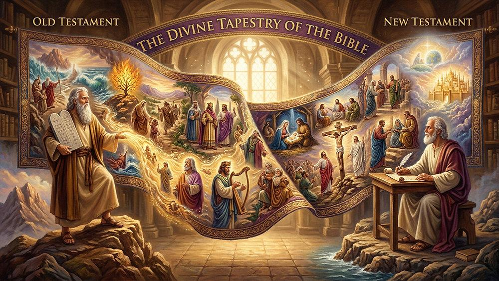
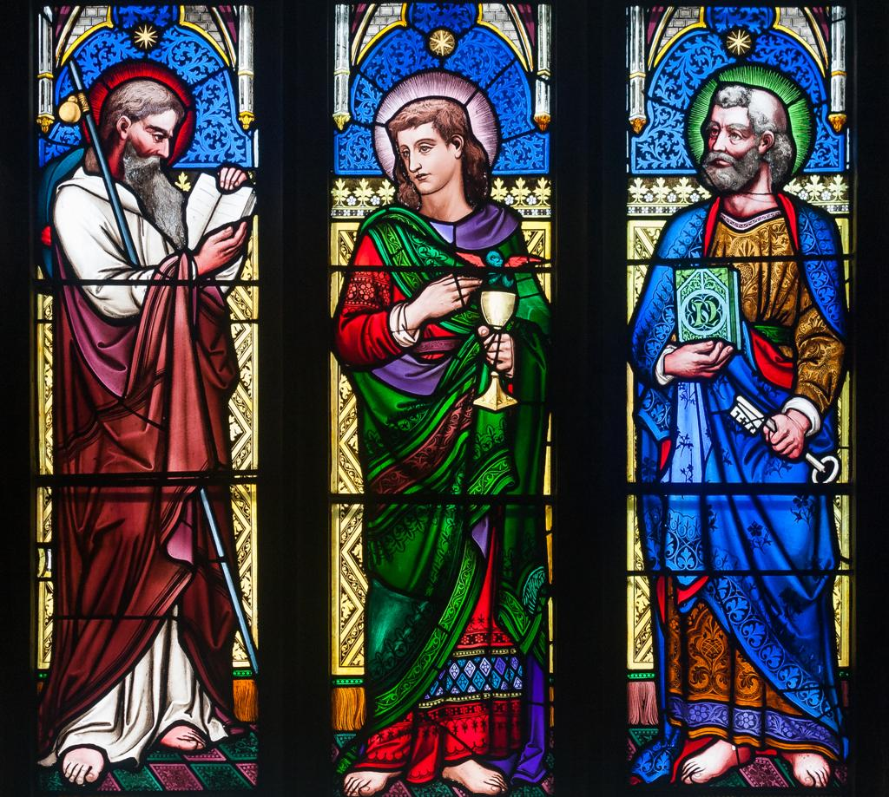
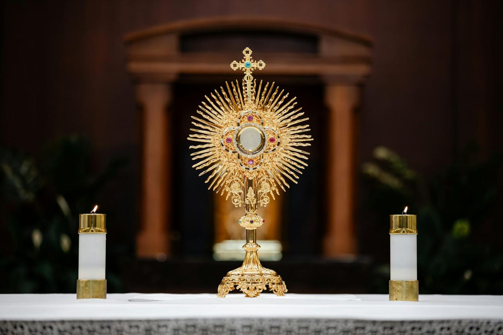

  

## Criteria for Interpretation of Scripture

We, too, must learn to discern the "full sense" of Scripture as it includes both the literal and spiritual senses together. Still, this does not mean we should "read into" the Bible meanings that are not really there. Spiritual exegesis is not an unrestrained flight of the imagination. Rather, it is a sacred science that proceeds according to certain principles and stands accountable to sacred tradition, the Magisterium, and the wider community of biblical interpreters (both living and deceased).

In searching out the full sense of a text, we should always avoid the extreme tendency to "over-spiritualize" in a way that minimizes or denies the Bible's literal truth. St. Thomas Aquinas was well aware of this danger and asserted that "all other senses of Sacred Scripture are based on the literal" (**STh I, 1, 10, ad 1, quoted in CCC 116**). On the other hand, we should never confine the meaning of a text to the literal, intended sense of its human author, as if the divine Author did not intend the passage to be read in the light of Christ's coming.

Fortunately the Church has given us guidelines in our study of Scripture. The unique character and divine authorship of the Bible call us to read it "in the Spirit" (**Dei Verbum 12**). Vatican II outlines this teaching in a practical way by directing us to read the Scriptures according to three specific criteria:

1) We must "[be especially attentive to the content and unity of the whole Scripture'" (**CCC 112**).

2) We must "read the Scripture within 'the living Tradition of the whole Church'" (**CCC 113**).

3) We must "be attentive to the analogy of faith" (**CCC 114; cf. Rom 12:6**).

These criteria protect us from many of the dangers that ensnare readers of the Bible, from the newest inquirer to the most prestigious scholar. Reading Scripture out of context is one such pitfall, and probably the one most difficult to avoid. A memorable cartoon from the 1950s shows a young man poring over the pages of the Bible. He says to his sister: "Don't bother me now; I'm trying to find a Scripture verse to back up one of my preconceived notions. No doubt a biblical text pried from its context can be twisted to say something very different from what its author actually intended.

## The First Criterion

  

The Church's criteria guide us here by defining what constitutes the authentic "context" of a given biblical passage. The first criterion directs us to the literary context of every verse, including not only the words and paragraphs that surround it, but also the entire corpus of the biblical author's writings and, indeed, the span of the entire Bible. The complete literary context of any Scripture verse includes every text from Genesis to Revelation— because the Bible is a unified book, not just a library of different books. When the Church canonized the Book of Revelation, for example, she recognized it to be incomprehensible apart from the wider context of the entire Bible.

## The Second Criterion

  

The second criterion places the Bible firmly within the context of a community that treasures a "living tradition". That community is the People of God down through the ages. Christians lived out their faith for well over a millennium before the printing press was invented. For centuries, few believers owned copies of the Gospels, and few people could read anyway. Yet they absorbed the gospel-through the sermons of their bishops and clergy, through prayer and meditation, through Christian art, through liturgical celebrations, and through oral tradition. These were expressions of the one "living tradition", a culture of living faith that stretches from ancient Israel to the contemporary Church. For the early Christians, the gospel could not be understood apart from that tradition. So it is with us. Reverence for the Church's tradition is what protects us from any sort of chronological or cultural provincialism, such as scholarly fads that arise and carry away a generation of interpreters before being dismissed by the next generation.

## The Third Criterion

  

The third criterion places scriptural texts within the framework of faith. If we believe that the Scriptures are divinely inspired, we must also believe them to be internally coherent and consistent with all the doctrines that Christians believe. Remember, the Church's dogmas (such as the Real Presence, the papacy, the Immaculate Conception) are not something added to Scripture; rather, they are the Church's infallible interpretation of Scripture.

## **References**
1. **CCC :** Catechism of the Catholic Church
2. **Rome 12:6:** "We have gifts that differ according to the grace given to us: prophecy, in proportion to faith;" 
