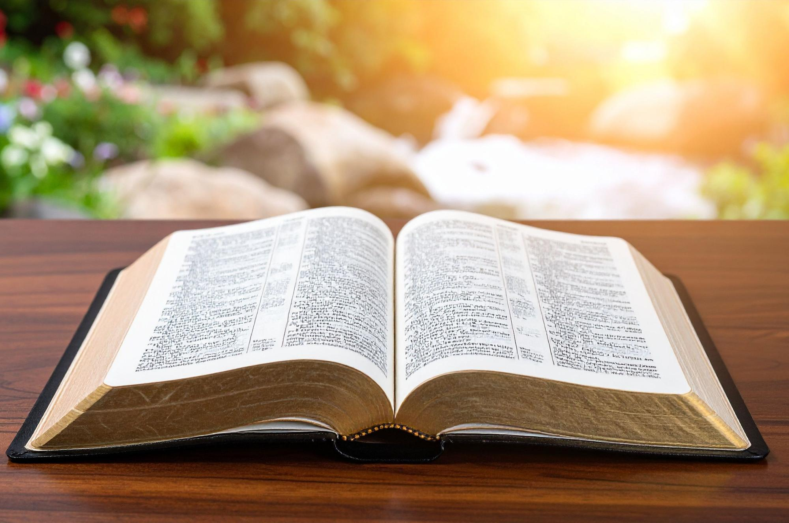

  

The following articles are some basic concepts about Scriptures and why and how it is important to Christian lives. The author of these articles is Scott Hahn, Ph.D of Saint Paul Center. Dr. Scott Hahn is an renowned American Catholic theologian and scholar on Scripture. These articles are extracted from **"Introduction to the Ignatius Catholic Study Bible"** written by Dr. Scott Hahn for the Ignatius Catholic Study Bible by Ignatius Press.

# Table of Content


## [{{ post.title }}]({{ post.url }})
[Read more →]({{ post.url }})


